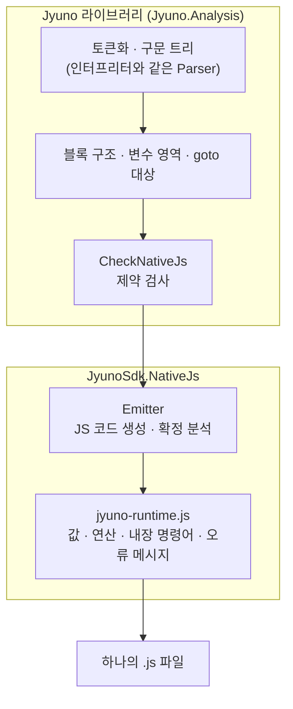

# Native JS 동작 원리

Native JS의 목표는 **"C# 인터프리터와 똑같이, 하지만 JS 엔진의 속도로"** 입니다. 출력뿐 아니라 반환값과 타입, 오류 메시지, 오류가 난 줄까지 같아야 합니다. 이 페이지는 Jyuno의 의미론을 JS로 옮긴 방법을 설명합니다.

## 전체 구조



분석은 인터프리터와 **같은 저장소의 같은 규칙**으로 하고(`Jyuno.Analysis`), JyunoSdk는 그 결과로 JS 코드만 만듭니다. 그래서 Jyuno에 문법이 추가되면 분석은 한 곳만 고치면 됩니다.

## 기능별로 옮긴 방법

| 기능 | C# 인터프리터 | Native JS | 난이도 |
| --- | --- | --- | --- |
| 변수와 영역 | 대입하면 영역 체인에서 먼저 찾은 변수를 바꾸고, 없으면 현재 영역에 만듦 | 영역마다 JS `let` 칸을 미리 만들고 "아직 없음(U)"으로 채움. 항상 있는 변수는 검사 없이 직접 접근 | 중간 |
| 함수와 재귀 | 호출 깊이 200 제한 | JS 함수 + 깊이 카운터 | 쉬움 |
| goto와 레이블 | 레이블은 줄 번호를 담은 변수, 계산한 줄로도 이동 | 대상이 있는 구간만 `for(;;){switch(pc)}` 루프로 | 어려움 (제약) |
| 64비트 정수 | `long`, 넘치면 순환 | ±2^53 안은 JS number, 넘으면 BigInt로 계산 후 64비트로 자름 | 중간 |
| 정수와 실수 구분 | `1`은 long, `1.0`은 double (출력도 다름) | 정수 값을 가진 double만 `JDouble` 상자에 담음 | 중간 |
| 실수 출력 | .NET 최단 왕복 표현, 10^17 이상은 `1E+17` | .NET 규칙을 그대로 구현 | 중간 |
| 연산 오류 메시지 | C# `dynamic`(RuntimeBinder) 메시지 | 타입 조합별 메시지를 재현 | 중간 (양이 많음) |
| 배열과 리스트 | `IList`, 요소 타입 추론 | `JList` (크기 고정 여부 + 요소 타입) | 쉬움 |
| 줄 단위 문법 오류 | 그 줄에 도달했을 때 보고 | 그 자리에서 오류를 던지는 코드로 변환 | 쉬움 |
| 오류 줄 번호 | 실행 중인 줄을 매번 기록 | 스택 트레이스를 Jyuno 줄로 바꿈 (실행 중 비용 0) | 중간 |
| 문자열 서식 | `string.Format` | 자주 쓰는 지정자(D, X, F, N, P, E, G, R) 구현 | 중간 |
| 구조체 (1.5.1부터) | 영역 하나가 구조체 값, 대입할 때 멤버 이름(`p.x`)을 선언, 읽고 넣을 때 깊은 복사 | 구조체마다 고정 모양 JS 클래스, 멤버 이름은 쓰는 자리에서 필드로 찾음, 넣을 때만 깊은 복사 | 중간 |

정리하면 대부분은 어렵다기보다 **양이 많은** 일이고, 구조적으로 JS에 맞지 않는 것은 블록 안쪽으로 들어가는 goto 하나입니다.

## 값 표현

| Jyuno | JS |
| --- | --- |
| `null` | `null` |
| `bool` | `true` / `false` |
| `int` (C# `long`) | 정수인 `number` (±2^53 안), 그 밖의 long 범위는 `BigInt` |
| `double` | 정수가 아닌 `number` (NaN, ±Infinity 포함). 정수 값인 double(`3.0`, `-0.0`)만 `JDouble` 상자 |
| `string` | `string` (C#과 JS 모두 UTF-16이라 길이·인덱스·비교가 같음) |
| 배열 / 리스트 | `JList { e: 요소 타입, fixed: 배열인지, a: JS 배열 }` |
| `func`로 만든 함수 | JS 함수 |
| 구조체 값 (`struct`) | 구조체마다 만든 `JStruct` 하위 클래스 (`$T…`)의 객체. 필드는 `f_이름` 속성, 아직 만들지 않은 필드는 `U` |

핵심은 **"정수인 number는 int"** 라는 규칙 하나입니다. 덕분에 흔한 경우(정수 연산, 정수가 아닌 실수)는 상자 없이 계산하고, 추가 비용은 비교 한 번 정도입니다.

## 변수와 영역

Jyuno는 실행하면서 변수를 만들지만, **어느 영역에 만들지는 코드만 보고 알수 있습니다.** 그래서

1. 영역마다 JS `let` 칸을 미리 만들고 "아직 없음(`U`)"으로 채웁니다.
2. 읽을 때는 `U`가 아닌 가장 가까운 칸을 고릅니다. 이것이 인터프리터의 이름 찾기와 같습니다.
3. **확정 분석**으로 각 지점에서 칸이 반드시 있는지(D) / 반드시 없는지(U) / 모르는지(M)를 추적해, 대부분의 검사를 없앱니다.
4. 함수가 바깥 변수를 쓰는 것은 JS 클로저가 그대로 처리합니다.

```js
// i = add i 1   (i가 있는지 모르는 지점)
($t1 = add2(($0_i !== U ? $0_i : $unknownVar("i")), 1), ($0_i !== U ? $0_i = $t1 : $0_i = $t1), null);

// return (add (fib (sub n 1)) ...)   (n은 반드시 있음 → 검사 없음)
return add2($0_fib(sub2($1_n, 1)), $0_fib(sub2($1_n, 2)));
```

## 구조체

Jyuno 1.5.0의 구조체는 인터프리터에서 **영역 하나**로 구현되어 있습니다. 생성자를 실행한 영역이 곧 구조체 값이고, 변수에 넣으면 `p.x`, `p.show` 같은 멤버 이름을 그 변수의 영역에 따로 선언합니다. 이 방식을 JS로 그대로 옮기면(이름 → 값 `Map`) 2~40배 느려서, Native JS는 다음처럼 바꿨습니다.

1. **구조체마다 JS 클래스 하나.** 생성자에서 만들수 있는 이름(필드와 구조체 함수)은 코드만 보고 알수 있으므로, 그 이름들을 속성으로 가진 클래스를 파일 맨 위에 만듭니다. 모든 값이 같은 모양이라 V8이 빠르게 다룹니다.
2. **멤버 이름은 쓰는 자리에서 찾기.** `p.x`를 따로 선언하지 않고, `p`가 구조체 값이면 그 `f_x` 필드를 읽습니다. 아니라면 인터프리터와 같은 "알수 없는 이름" 오류를 냅니다.
3. **구조체 함수는 공유.** 구조체 함수는 값마다 새로 만들지 않고, 하나의 함수가 `this`로 구조체 값을 받습니다.
4. **넣을 때만 복사.** 인터프리터는 읽을 때와 넣을 때 모두 복사하지만, Native JS는 변수·필드·컬렉션에 **넣을 때**(대입, 인자, 반환, 리스트에 추가)만 복사합니다. 리스트 안의 구조체 값은 바뀔 일이 없으므로 복사하지 않고 공유합니다.
5. **같은 값 비교와 문자열은 생성 코드로.** `equal`은 구조체마다 만든 `$same`이 필드를 차례로 비교하고, `string`은 `point { x = 1, y = 2 }` 형식으로 만듭니다. 필드 순서(만든 순서)는 `$o` 배열에 기록합니다.

```jyuno
struct point
    param x
    param y
    func move
        param dx
        x = add x dx
    endfunc
endstruct
p = point 1 2
q = p
q.move 10
```

```js
class $T1 extends JStruct { constructor(o, f_x, f_y, f_move) { super(); this.$o = o; this.f_x = f_x; this.f_y = f_y; this.f_move = f_move; } }

// 구조체 함수: 하나를 만들어 모든 값이 공유 (this가 구조체 값)
const $m3 = function $f_move($a0) { const $s1 = this; /* ... */ $s1.f_x = add2($s1.f_x, $2_dx); return null; };

($t0 = own($0_point(1, 2)), $0_p = $t0, null);   // 넣을 때 복사
($t1 = own($0_p), $0_q = $t1, null);             // q = p 도 복사
((($t2 = $0_q) instanceof JStruct && ($t3 = $t2.f_move) !== undefined && $t3 !== U) ? $t2.f_move(10) : $unknownCall("q.move")(10));
```

구조체를 쓰지 않는 프로그램은 생성 코드가 이전과 **완전히 같습니다.** 구조체 연구에서 인터프리터와 비교한 구조체 스크립트 1,054개는 의도한 제약 1개를 빼고 모두 같은 결과를 냈고, 구조체 벤치마크는 .NET 8 인터프리터보다 9~64배(기하평균 약 29배) 빨랐습니다.

## 내장 함수

내장 함수는 재정의할수 없으므로([[제약|Native-JS-Restrictions]]), 호출을 **인자 개수에 맞는 빠른 함수**(`add2`, `add3`, `less2`, `not1`, `length1` …)로 바로 바꿉니다. 이름을 찾거나 인자 배열을 만들 필요가 없어서 V8이 인라인하기 좋습니다.

## goto

goto의 **대상이 있는 구간만** 디스패치 루프로 바꾸고, goto는 `pc`를 바꾼 뒤 `continue`합니다. goto가 없는 코드는 평범한 JS 제어문(`if`, `while`, `for`)이 됩니다.

```jyuno
i = 0
top:
i = add i 1
if (less i 5)
    goto top
end
console.writeline i
```

```js
{ let $pc1 = 0; $D1: for (;;) { switch ($pc1) { case 0:
($t0 = 0, ($0_i !== U ? $0_i = $t0 : $0_i = $t0), null);
case 1:
($0_top = 1, null);
($t1 = add2(($0_i !== U ? $0_i : $unknownVar("i")), 1), ($0_i !== U ? $0_i = $t1 : $0_i = $t1), null);
if (less2(($0_i !== U ? $0_i : $unknownVar("i")), 5)) {
{ const $g4 = $0_top; if ($g4 === 1) { $pc1 = 1; continue $D1; } $gotoFail($g4, 4); }
}
$h0([($0_i !== U ? $0_i : $unknownVar("i"))]);
} break; } }
```

레이블이 여러 번 대입되거나 값이 계산되면 후보 레이블을 모두 비교하고, 맞는 것이 없으면 인터프리터와 같은 검사를 한 뒤 제약 오류를 냅니다.

## 오류 줄 번호

인터프리터는 줄마다 "지금 실행 중인 줄"을 기록합니다. Native JS는 대신 **생성 코드의 JS 줄 → Jyuno 줄 대응표**(`lineMap`)를 만들어 두고, 오류가 났을 때만 예외의 스택 트레이스에서 찾습니다. 그래서 정상 실행 중에는 **비용이 0**이고, 무작위 테스트에서 오류 줄 번호까지 모두 일치했습니다.

## 안전

- 생성 코드의 모든 이름에는 `$` 접두사가 붙고 특수 문자는 바꿔 적습니다(`text.at` → `text_002eat`). Jyuno 이름이 `window`, `fetch`, `globalThis` 같은 JS 전역에 닿을 길이 없습니다.
- 호스트 이름은 `Map`으로만 찾습니다.
- 문자열은 이스케이프해서 넣고, 정수 값 실수 같은 상수는 배열로 따로 넘깁니다.
- 실행은 웹 워커 안에서 하는 것을 권장합니다. 무한 반복은 워커를 종료해서 멈춥니다.
