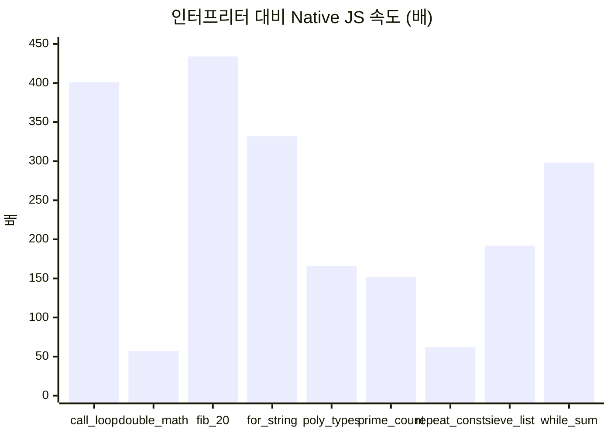

# Native JS 연구 결과

Native JS는 "Jyuno를 JS로 변환하면 얼마나 빨라지고, 언어를 얼마나 바꿔야 할까?"라는 질문에서 시작한 연구입니다. Jyuno 1.3.2를 JS 함수로 컴파일하는 프로토타입(순수 JS 모듈 5개, 약 1,900줄)을 만들어 C# 인터프리터와 직접 비교했습니다.

> **결론: 실현 가능하고, 효과도 매우 큽니다.**
> 언어를 거의 그대로 둔 채 변환할수 있었고, 웹 실행기보다 **기하평균 약 190배** 빨랐습니다. 무작위 프로그램 2만 개에서 인터프리터와 **불일치 0개**였습니다.

이후 실제 도입(Jyuno 1.4.0)에서 분석과 제약 검사는 Jyuno 라이브러리의 `Jyuno.Analysis`로, JS 코드 생성과 런타임은 `JyunoSdk.NativeJs`로 옮겼습니다.

## 성능

### 측정 방법

- 이전 Dynamic PGO 연구에서 쓴 **벤치마크 프로그램 9개**를 네 가지 방식으로 실행했습니다.
- 브라우저 세 가지는 같은 Chromium에서 **JyunoWeb과 똑같이 웹 워커 안에서** 실행했습니다.
- 시간은 **매번 새로 컴파일하고 실행한** 시간의 중앙값입니다. (.NET은 7회 중 뒤 5회, Native JS는 40회 중 뒤 20회)
- 모든 실행에서 결과값이 서로 같았습니다.
- 환경: 클라우드 리눅스 컨테이너, Chromium 153 headless, Node 22, .NET 10.0.14. 절대 시간은 기기마다 다르지만 비율은 비슷할 것으로 봅니다.

### 결과 (ms, 낮을수록 좋음)

| 프로그램 | WASM 인터프리터 (현재 웹) | WASM AOT | .NET 10 JIT (참고, 네이티브) | **Native JS** | 인터프리터 대비 |
| --- | ---: | ---: | ---: | ---: | ---: |
| `call_loop_50k` | 240.6 | 66.9 | 19.1 | **0.6** | **×401** |
| `double_math_100k` | 277.7 | 89.8 | 25.9 | **4.9** | **×57** |
| `fib_20` | 130.3 | 27.1 | 10.5 | **0.3** | **×434** |
| `for_string_1000x100` | 331.9 | 75.6 | 21.7 | **1.0** | **×332** |
| `poly_types_60k` | 448.6 | 121.9 | 24.5 | **2.7** | **×166** |
| `prime_count_3000` | 121.7 | 37.4 | 9.4 | **0.8** | **×152** |
| `repeat_const_200k` | 314.9 | 86.4 | 17.3 | **5.1** | **×62** |
| `sieve_list_20k` | 383.0 | 141.5 | 20.7 | **2.0** | **×192** |
| `while_sum_200k` | 537.2 | 135.4 | 33.2 | **1.8** | **×298** |
| **기하평균 (Native JS 대비)** | **×188** | **×52** | **×13** | | |



- **가장 큰 차이**: 함수 호출과 정수 연산이 많은 `fib_20`, `call_loop`. V8이 생성 코드를 기계어로 직접 컴파일하기 때문에, 인터프리터 위에서 인터프리터를 돌리는 구조와 차이가 큽니다.
- **가장 작은 차이**: `double_math`(실수 연산과, 결과가 정수 값인 실수를 상자에 담는 비용), `repeat_const`(인자가 세 개인 `add`가 빠른 경로를 타지 못하고, C#처럼 상수 접기를 하지 않음).
- 아직 최적화할 여지가 있습니다. 인자 셋 이상의 빠른 경로, 상수끼리 연산 미리 계산, goto 구간 안의 확정 분석만 해도 느린 두 프로그램은 몇 배 더 빨라질 것으로 봅니다.
- 브라우저 타이머 해상도가 0.1 ms라서 `fib_20`(0.3 ms) 같은 짧은 값은 ±30% 정도 오차가 있습니다.

### 시작 시간과 크기

| 측정 | WASM 인터프리터 | WASM AOT | **Native JS** |
| --- | ---: | ---: | ---: |
| 워커 준비 시간 (캐시된 상태) | 337 ms | 404 ms | **46 ms** |
| 프로그램 첫 실행 (컴파일 포함) | 124~765 ms | 47~177 ms | **1.4~33 ms** |
| 압축 후 다운로드 (brotli) | 2.0 MB | 4.7 MB | **16 KB** |

- 변환은 프로그램마다 **0.05~0.25 ms**입니다.
- Node 22에서 새 프로세스로 한 번만 실행해도(JIT 예열 없음) 8~29 ms였습니다.

### 채점에 미치는 영향

JyunoWeb 채점 문제 53개의 테스트 케이스 510개를 Native JS로 실행하면 **케이스당 평균 0.22 ms, 최대 12.9 ms**입니다. 지금의 시간 제한은 WASM 인터프리터 속도에 맞춰져 있으므로, 채점에 Native JS를 쓰려면 시간 제한을 다시 정해야 합니다.

## 호환성 검증

같은 코드를 Jyuno C# 인터프리터(기준 실행기)와 Native JS로 돌려서 **출력, 반환값과 타입, 오류 메시지, 오류 줄 번호, 예외 종류**를 모두 비교했습니다. (차등 테스트)

| 대상 | 규모 | 결과 |
| --- | --- | --- |
| Jyuno.Tests가 실행하는 스크립트 | 299개 | 298개 일치, 1개는 [블록 구조 오류를 실행 전에 보고](Native-JS-Restrictions#블록-구조-오류는-실행-전에-알려줍니다)하는 차이 |
| JyunoWeb 채점 문제 | 53문제, 테스트 케이스 510개 (숨겨진 테스트 포함) | **53문제 모두 AC** |
| 플레이그라운드 예제 | 19개 중 17개 (random/time, 무한 반복 제외) | 17개 모두 일치 |
| 무작위 프로그램 | 씨앗 10개 × 2,000개 = **20,000개**, 평균 약 59줄 | **불일치 0개** |

무작위 프로그램 생성기는 함수, 재귀, 중첩 반복문, 레이블과 goto, 리스트와 문자열, 실수 출력, long 오버플로우, 내장 함수 재정의, 상수 대입, 타입이 맞지 않는 연산을 섞어 만듭니다. 약 4분의 1은 끝까지 실행되고 나머지는 일부러 넣은 오류로 멈추므로, **오류 메시지와 줄 번호도 많이 검증됩니다.**

**테스트가 실제로 차이를 잡는지**도 확인했습니다. 실수 출력이 과학 표기법으로 바뀌는 경계(10^17)를 일부러 한 자리 바꾸자 무작위 테스트에서 **296건의 불일치**가 나왔습니다. 개발 중에도 이 테스트로 "문자열 + 리스트" 연산 순서, 정수 값 실수를 정수로 바꾸는 호스트 함수, 문자열 상수로의 goto 등 여러 차이를 찾아 고쳤습니다.

검증하지 못한 부분도 있습니다. `math.sin` 같은 초월 함수의 마지막 비트, 드문 문자열 서식, `text.upper`의 특수 문자 대소문자는 생성기가 거의 만들지 않으므로 따로 테스트가 필요합니다.

## 다른 방안과의 비교

| 방안 | 속도 (현재 웹 인터프리터 대비) | 다운로드 | 언어 차이 |
| --- | --- | --- | --- |
| WASM AOT | 약 3.6배 | 늘어남 (+51%~+138%) | 없음 |
| 인터프리터 내부 정적 특수화 | 약 1.25배 (브라우저) | 그대로 | 없음 |
| **Native JS** | **약 190배** | 워커는 +16 KB, 화면까지 JS로 바꾸면 약 −2 MB | 제약 3개 |

## 대가: 유지보수

Native JS는 공짜가 아닙니다. Jyuno의 의미론(정수/실수 표현, C# `dynamic` 오류 메시지, .NET 숫자 서식)을 **JS 쪽에서 한 벌 더** 관리해야 합니다. 그래서

1. **C# 인터프리터를 기준(정답) 구현**으로 둡니다.
2. 같은 코드를 둘 다 돌려 비교하는 **차등 테스트**로 어긋남을 잡습니다. (JyunoSdk 테스트에도 들어 있습니다)
3. 오류 메시지 상당수가 C# `dynamic`의 메시지를 그대로 옮긴 것이라, 장기적으로는 Jyuno가 자기 메시지를 갖는 편이 양쪽 모두에 좋습니다.

## 재현

연구용 프로토타입과 측정 도구는 JyunoWeb 저장소 커밋 [`4eace34`의 `native-js/` 폴더](https://github.com/jyunrcaea/JyunoWeb/tree/4eace34/native-js)에 남아 있습니다.

```sh
cd native-js
# C# 기준 실행기 (Jyuno 소스가 JyunoWeb과 같은 상위 폴더에 있어야 함)
dotnet build ref/RefRunner -c Release
R=ref/RefRunner/bin/Release/net10.0/RefRunner.dll
dotnet $R problems > test/data/problems.json
dotnet $R examples > test/data/examples.json

node test/jyuno-tests.mjs        # Jyuno.Tests 스크립트 299개
JYUNO_SOLUTIONS=<풀이 폴더> node test/judge.mjs
node test/examples.mjs
node test/fuzz.mjs 2000 1        # 무작위 프로그램 2000개, 씨앗 1

node bench/node-bench.mjs 100
dotnet $R bench bench/programs 30
```

채점 문제 풀이는 문제가 공개될수 있어서 저장소에 올리지 않았습니다.
