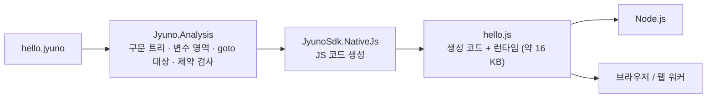

# Native JS

**Native JS**는 Jyuno 코드를 **JavaScript로 변환**하는 기능입니다. 만들어진 `.js` 파일 하나에 Jyuno 런타임(값, 연산, `console`·`math` 명령어)이 모두 들어 있어서, 다른 파일이나 .NET 없이 **Node.js와 브라우저에서 바로 실행**됩니다.

```
$ jyuno fib.jyuno --native-js
fib.jyuno → fib.js (Native JS, 실행: node fib.js)
$ node fib.js
fib 25 = 75025
```

## 한눈에 보기

| | |
| --- | --- |
| 🚀 **속도** | 웹(JyunoWeb)의 WASM 인터프리터보다 **기하평균 약 190배**, WASM AOT보다 **약 50배**, 네이티브 .NET 10 JIT로 돌린 C# 인터프리터보다도 **약 13배** 빠름 |
| 🪶 **크기** | 변환기와 런타임을 합쳐 **압축 후 약 16 KB** (.NET WASM 런타임은 2.0 MB) |
| ⏱️ **시작 시간** | 워커 준비 337 ms → **46 ms**, 첫 실행(변환 포함) 124~765 ms → **1.4~33 ms** |
| ✅ **호환성** | 무작위 프로그램 **20,000개** 불일치 0개, JyunoWeb 채점 **53문제 510케이스 모두 AC**, Jyuno.Tests 스크립트 299개 중 298개 일치 |
| 🧱 **제약** | 주요 언어 제약은 **세 가지**: 삭제(`x =`) 금지, 내장 함수/상수 재정의 금지, 블록 안쪽으로 들어가는 `goto` 금지 (구조체는 1.5.1부터, 연산자와 구조체의 연산자 함수는 1.6.0부터 지원하며, 구조체 안의 구조체 같은 드문 경우만 제약) |

> 숫자는 연구용 프로토타입(Jyuno 1.3.2 기준)으로 측정한 값입니다. 자세한 조건과 표는 [[연구 결과|Native-JS-Research]]에 있습니다.

## 왜 만들었나요?

Jyuno는 C# 프로그램 안에서 돌아가는 인터프리터 언어라, 웹에서 쓰려면 Blazor WebAssembly로 **.NET 런타임을 통째로** 브라우저에 내려받아야 했습니다. 그 위에서 또 Jyuno 인터프리터가 한 줄씩 해석하니, "인터프리터 위의 인터프리터"가 되어 느렸습니다.

먼저 검토한 방법은 .NET 쪽을 빠르게 하는 것이었습니다.

- **WASM AOT 컴파일**: 약 3.6배 빨라지지만 다운로드가 51~138% 늘어남
- **인터프리터 내부 정적 특수화**: 브라우저에서 약 1.25배

Native JS는 방향을 바꿔, **Jyuno 코드를 JS 코드로 한 번 번역**하고 실행은 브라우저의 JS 엔진(V8 등)에 맡깁니다. JS 엔진이 생성 코드를 기계어로 직접 컴파일하므로, 해석 단계가 통째로 사라집니다.



## 이렇게 바뀝니다

```jyuno
func fib
    param n
    if (less n 2)
        return n
    end
    return (add (fib (sub n 1)) (fib (sub n 2)))
endfunc

console.writeline "fib 25 = {1}" (fib 25)
```

`jyuno fib.jyuno --native-js`가 만드는 프로그램 부분입니다. (JyunoSdk 0.2.0 실제 출력)

```js
let $0_fib = U;
$0_fib = function $f_fib($a0) {
if ($depth >= 200) $tooDeep(); $depth++; try {

let $1_n = U;
$1_n = ($a0 === undefined ? null : $a0);
if (less2($1_n, 2)) {
return $1_n;
}
return add2($0_fib(sub2($1_n, 1)), $0_fib(sub2($1_n, 2)));
return null; } finally { $depth--; } };
$h0(["fib 25 = {1}", $0_fib(25)]);
```

- Jyuno 함수는 **평범한 JS 함수**가 되고, 재귀 깊이 200 제한도 그대로 지킵니다.
- `add`, `sub`, `less`는 재정의될 수 없으므로 인자 개수에 맞는 **빠른 연산 함수**(`add2`, `less2`)를 바로 부릅니다.
- `n`은 항상 값이 있다는 것을 분석으로 알기 때문에 **검사 없이** 읽습니다.
- 모든 이름에 `$` 접두사가 붙어서 Jyuno 코드가 `window`, `fetch` 같은 JS 전역에 닿을수 없습니다.

## 3분 만에 써보기

1. JyunoSdk 0.2.0 이상을 설치합니다. (`dotnet tool install -g JyunoSdk` 또는 [Releases](https://github.com/jyunrcaea/JyunoSdk/releases))
2. 변환합니다: `jyuno hello.jyuno --native-js`
3. 실행합니다: `node hello.js` (표준 입출력 사용)

브라우저에서는 `<script src="hello.js"></script>`로 넣고 `JyunoProgram.run({ write: text => ... })`를 부르면 됩니다. 자세한 사용법은 [[사용하기|Native-JS-Usage]]를 보세요.

[JyunoWeb 플레이그라운드](https://jyunrcaea.github.io/JyunoWeb/playground)에서도 샌드박스 설정의 **Native JS (실험)** 를 켜면 같은 변환기로 실행해 볼수 있습니다.

## 다음 읽을거리

- [[사용하기|Native-JS-Usage]] — 명령어, JS API, 호스트 함수, C# 라이브러리
- [[제약과 차이점|Native-JS-Restrictions]] — 변환할수 없는 코드와 그 이유
- [[동작 원리|Native-JS-Internals]] — 인터프리터와 똑같이 동작하게 만든 방법
- [[연구 결과|Native-JS-Research]] — 벤치마크와 호환성 검증
